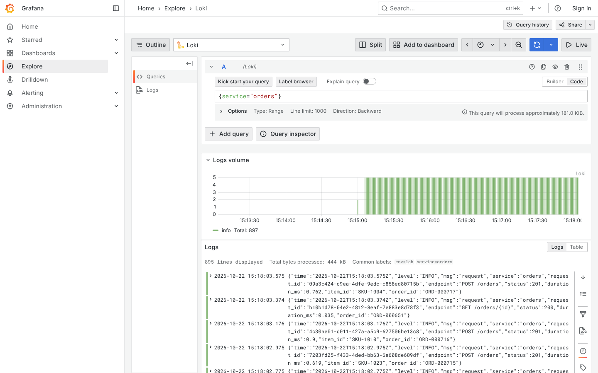
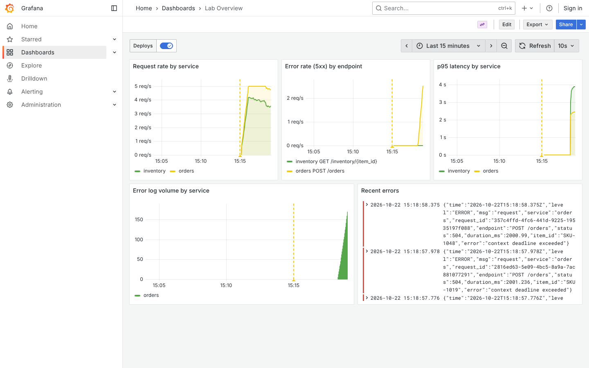
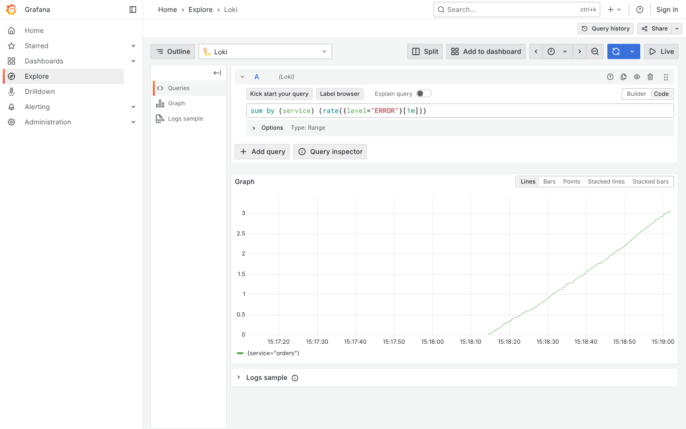
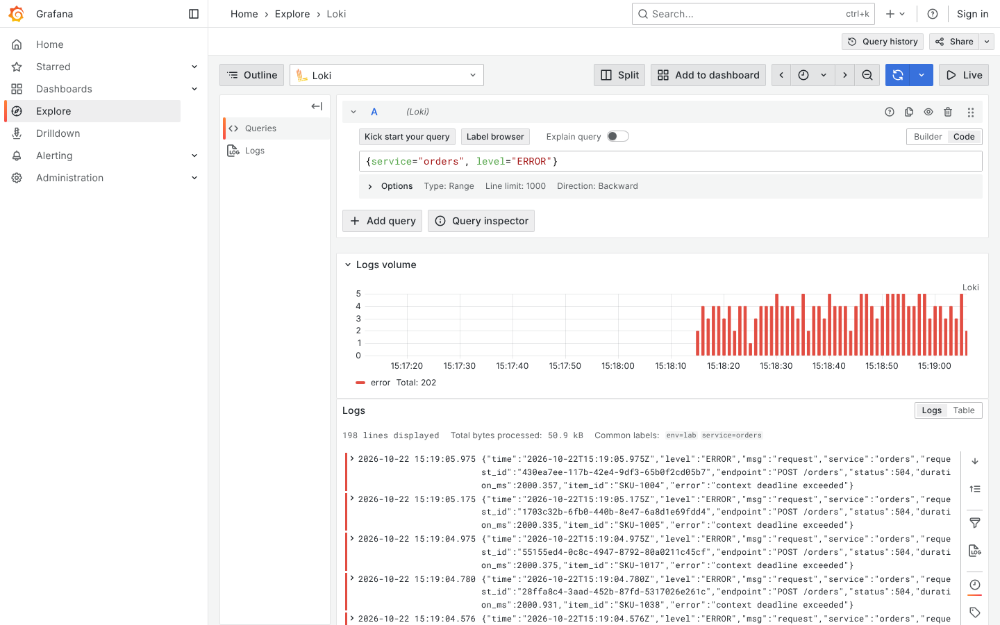
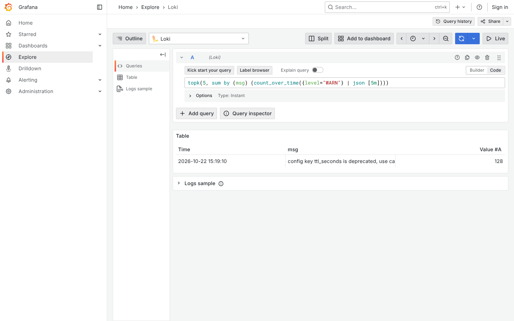
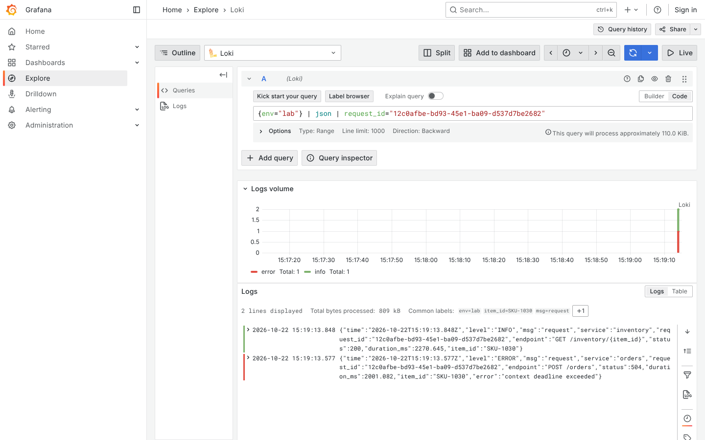
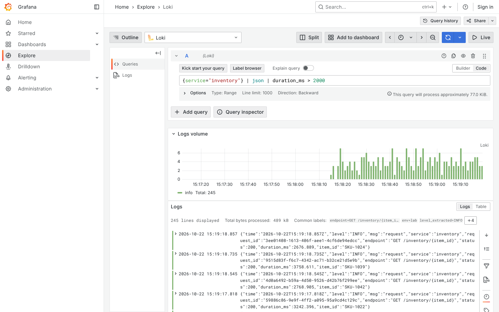

# Live demo: one problem, start to finish (15 minutes)

The demo uses mode A only. Attendees meet the other modes for the first time in the hands-on part, so don't show or mention them.

**Before the session:** start the lab, run `./check.sh`, and open **Lab Overview** (last 15 minutes, refresh every 5 s) in one tab and **Explore** (Loki) in another. Paste each query below from this file. If the live lab misbehaves, show the screenshot under the step instead.

Mode A ends by itself after 3 minutes, and its logs stay in Loki. Before each Explore step, set the time picker to start a minute before you ran `./incident.sh A`. If you need it running again, run `./incident.sh A` again.

## Step 1. The healthy lab (2 min)

Show the dashboard: request rate, 5xx rate, p95 latency, error log volume, and recent errors. Every panel is a view over the same logs and metrics. Then open Explore and show where the logs come from: three labels (`service`, `level`, `env`) and a JSON line with `request_id`, `endpoint`, `status` and `duration_ms`.

```logql
{service="orders"}
```



## Step 2. Break it (2 min)

Run `./incident.sh A` in a terminal. Within 30 s, on the dashboard, orders' 5xx rate rises and inventory's p95 latency climbs past 2 s. The panel behind the latency line runs this PromQL. Ask the room: which service is broken?

```promql
histogram_quantile(0.95, sum by (service, le) (rate(http_request_duration_seconds_bucket[1m])))
```



## Step 3. Who is logging errors? (1 min)

Count ERROR lines per second by service. Only orders logs errors. Inventory is slow, but it isn't failing.

```logql
sum by (service) (rate({level="ERROR"}[1m]))
```



## Step 4. Read the errors (2 min)

Open the ERROR lines. Each one is a `504` with `error="context deadline exceeded"`: orders gave up waiting for inventory. Expand a line and copy its `request_id`.

```logql
{service="orders", level="ERROR"}
```



## Step 5. Is the warning to blame? (2 min)

Show the most frequent WARN messages, run as an instant query (**Options** → **Type: Instant**) so the counts show as a table. The top one is inventory's config deprecation warning. It fires every 2 s, healthy or not, so it isn't the cause. `!= "deprecated"` hides it; try it on `{level="WARN"}`.

```logql
topk(5, sum by (msg) (count_over_time({level="WARN"} | json [5m])))
```



## Step 6. Follow one request (3 min)

Paste the `request_id` from step 4. Orders logs the 504 after 2 s. Inventory logs the same request later, as a `200` with `duration_ms` above 2000: it answered, but too late. The root cause is in inventory, not orders.

```logql
{env="lab"} | json | request_id="<request_id>"
```



## Step 7. Is it every request? (2 min)

Show every inventory request slower than orders' 2 s timeout. It isn't one bad request: they all are, from the moment the mode started. Then run `./incident.sh clear`, or wait for it to end, and show the latency panel coming back down.

```logql
{service="inventory"} | json | duration_ms > 2000
```



## Wrap-up (1 min)

The path was: a dashboard signal, the errors behind it, the noise set aside, one request followed across services, then the pattern confirmed. Every LogQL query came from the cheat sheet. Hand out the worksheet.
